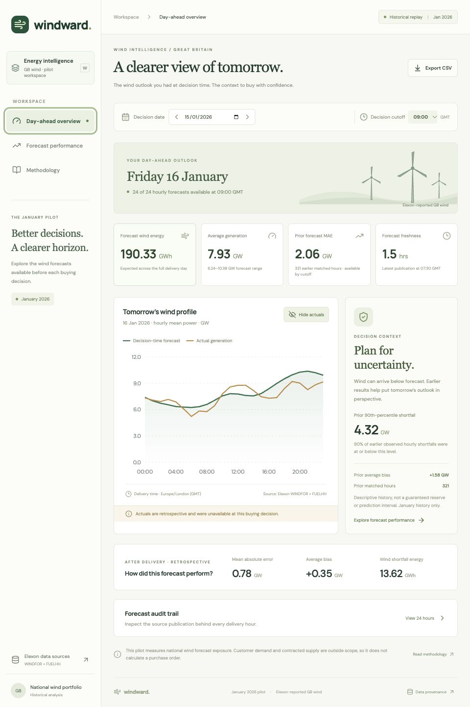

# Windward

A React + Python pilot for reviewing **Elexon-reported GB wind forecasts available at a historical day-ahead buying decision**, and quantitatively evaluating those forecasts against actual generation.

**Live application:** [Open Windward](https://q7m4v9k2-gray.vercel.app) · [API health](https://q7m4v9k2-gray.vercel.app/api/health) · [API documentation](https://q7m4v9k2-gray.vercel.app/api/docs)

The production application and Python API have been deployed and checked without authentication.

**Demo video:** not recorded yet. The two-part recording guide is in [`docs/demo-script.md`](docs/demo-script.md). An unlisted YouTube video under ten minutes is mandatory for submission.

**Public repository:** [GitHpriyanshu23/q7m4v9k2](https://github.com/GitHpriyanshu23/q7m4v9k2)



## Product

- **Day-ahead overview:** January decision date, configurable GMT cutoff, next-day wind profile, forecast publication age, energy and power totals, prior-history error context, optional retrospective actuals, and an hourly publication audit trail.
- **Forecast performance:** decision-date range and cutoff filters; MAE, RMSE, bias, coverage, daily error, delivery-hour error patterns, and largest wind shortfall intervals.
- **Methodology:** alignment rules, equations, scope, and limitations, alongside an inspectable source manifest.
- **CSV export:** exports the selected decision date/range and cutoff with UTC delivery and publication timestamps, forecast MW, actual MW, and signed error MW.

No synthetic values are used. The bundled snapshot allows the deployed demo to work without depending on a live upstream API call.

## Run with Docker

Prerequisites: Docker Desktop / Docker Engine and Docker Compose.

```sh
docker compose up --build
```

Open **http://localhost:8000**. API documentation: **http://localhost:8000/api/docs**.

The multi-stage image builds React using Node and runs FastAPI as a non-root user. It serves the UI and API on one origin. `PORT` defaults to 8000 and can be overridden for hosting.

## Run for development

Prerequisites: Node.js 22+, Python 3.13, npm.

```sh
python3.13 -m venv .venv
source .venv/bin/activate
pip install -r requirements-dev.txt
npm ci
```

In one terminal:

```sh
source .venv/bin/activate
uvicorn backend.main:app --reload --host 127.0.0.1 --port 8000
```

In another:

```sh
npm run dev
```

Open **http://127.0.0.1:5173**. Vite proxies `/api` to port 8000. Production assets can also be built with `npm run build` and served by restarting FastAPI on port 8000.

## Data and interpretation

Only these sources are used:

- [Elexon WINDFOR stream](https://bmrs.elexon.co.uk/api-documentation/endpoint/datasets/WINDFOR/stream)
- [Elexon FUELHH stream](https://bmrs.elexon.co.uk/api-documentation/endpoint/datasets/FUELHH/stream), filtered to `fuelType = WIND`.

Exact download URLs, retrieval timestamp, record counts, and SHA-256 hashes of the normalized uncompressed JSON are in [`data/manifest.json`](data/manifest.json). Public Elexon APIs require no key. See the [Elexon developer portal](https://developer.data.elexon.co.uk/).

Refresh the snapshot from the repository root:

```sh
python scripts/ingest.py
```

The script uses only Python's standard library, retries transient failures, validates records, and downloads both datasets before replacing snapshot files. Restart the API after refreshing: the immutable snapshot is indexed in memory and cached for the process lifetime. Do not refresh while serving live requests; this is an offline preparation step for the pilot.

### Dates and cutoff

The brief says **purchase decisions made in January 2026**. We interpret that literally as decisions on **1–31 January**, for delivery on **2 January–1 February**. This differs from taking January delivery dates; the interpretation is explicit in the product and tests.

Default cutoff: **09:00 Europe/London**, a configurable pilot assumption, not a claim about a universal exchange gate closure. January is GMT / UTC+0. For each next-day delivery hour, choose the WINDFOR record having the greatest `publishTime` **less than or equal to the decision cutoff**. Later revisions are excluded, even if they are more accurate. A publication timestamp is used as the proxy for historical data availability; actual transport/ingestion latency is not reconstructed.

### Hourly forecast versus half-hour actuals

Inspection of all **18,688 WINDFOR rows** in the downloaded snapshot shows hourly target timestamps. The **1,488 FUELHH WIND rows** are half-hourly. We do **not** invent half-hour forecasts or interpolate them. Instead:

```text
hourly actual MW = (actual at HH:00 + actual at HH:30) / 2
```

Both half-hour actuals must exist; otherwise the hourly actual and error remain missing. Missing data is never zero-filled. Identical duplicates collapse; conflicting duplicates at the same target and publication timestamp raise an error. Latest actual versions in the snapshot are used in retrospective evaluation.

All accuracy metrics use matched hourly forecast/actual pairs. Forecast and actual energy totals use available intervals; incomplete forecast totals are labelled in the overview. Each complete hour represents one hour of mean power:

```text
error MW = forecast MW − actual MW
MAE MW = mean(abs(error))
RMSE MW = sqrt(mean(error²))
bias MW = mean(error)
shortfall MWh = sum(max(error, 0) × 1 hour)
coverage % = 100 × matched hours / expected hours
forecast MWh = sum(hourly forecast MW × 1 hour)
```

Positive error means wind was overestimated. The P90 shortfall uses the nearest-rank 90th percentile of `max(error, 0)`, **including zero shortfall hours**. It describes observed history; it is not a calibrated confidence interval or recommended reserve.

### Avoiding hindsight

The decision overview's prior-history context uses **only earlier January buying decisions**. For their outturns, it selects actual versions published by the current decision's cutoff. It can include already-published hours from a delivery day that is still in progress. It never uses the current decision's future delivery actuals or full-month results. Early January therefore has little or no prior history; matched sample counts are visible.

The **Reveal actuals** action and the performance page are explicitly retrospective. Their actuals are not information available when buying the following day's power. Full-month performance is never fed into a past decision as if it had been known then.

### Verified snapshot findings at 09:00 GMT

- 31 buying decisions, 744 expected hourly comparisons, **744 matched (100%)**.
- MAE: **2,038.91 MW**; RMSE: **2,504.76 MW**.
- Bias: **+1,747.89 MW**; forecasts overestimate wind in **84.95%** of matched hours.
- Largest hourly wind shortfall: **6,870 MW**.

These are retrospective findings for this specific source snapshot and alignment, not general claims about future forecast quality. Forecast/outturn coverage differences, revisions, and curtailment may contribute to errors.

## Scope and limitations

- Covers Elexon-reported GB wind, not all UK renewable generation or all embedded wind. Dataset comparability should be confirmed with the client before production use.
- No customer demand, portfolio allocation, contracted supply, market prices, or costs are supplied. The app cannot calculate a purchase order, financial loss, savings, or actual thermal procurement.
- Forecast error is not attributed solely to weather; actual generation can be affected by curtailment and operational conditions.
- Uses a reproducible historical snapshot, not live trading connectivity or a newly trained forecast model.
- Pilot freshness warning: any selected forecast older than 12 hours at cutoff is flagged. This is an explicit UI heuristic, not an industry service-level agreement.
- No authentication is needed for this public-data pilot. Production work would add authorization, monitoring, scheduled ingestion, richer coverage checks, and client-specific procurement inputs.

## Repository structure

```text
src/main.tsx                React views, controls, charts, audit trail, source dialog
src/styles.css              Responsive visual design
public/favicon.svg          Product icon
backend/analysis.py         Pure cutoff selection, time alignment, and metric functions
backend/main.py             FastAPI routes, snapshot cache, CSV, production static serving
api/index.py                Vercel Python entry point
scripts/ingest.py           Reproducible Elexon ingestion and source manifest
data/*.json.gz              Normalized real source snapshots
data/manifest.json          Source URLs, retrieval time, counts, and content hashes
tests/test_analysis.py      Hand-calculated examples and time/data edge cases
tests/test_api.py           Real snapshot, API validation, all dates/cutoffs, CSV checks
docs/demo-script.md         Customer + technical recording walkthrough
docs/dashboard-preview.jpg Deployed dashboard screenshot
docs/submission-checklist.md Required deliverables and access checks
.github/workflows/ci.yml    Python tests, React build, Docker build
Dockerfile                 Multi-stage Node build and non-root Python runtime
compose.yaml               One-command local container startup and health check
vercel.json                React build + Python API routing for Vercel
requirements*.txt           Python runtime and test dependencies
package*.json              Frontend scripts, dependencies, and exact npm lockfile
vite.config.ts             React build, chart chunking, and local API proxy
```

## API

- `GET /api/health` — snapshot readiness.
- `GET /api/meta` — data provenance, supported dates, and defaults.
- `GET /api/decision?decision_date=2026-01-15&cutoff=09:00` — next-day profile, retrospective actuals, and time-safe prior history.
- `GET /api/performance?start=2026-01-01&end=2026-01-31&cutoff=09:00` — selected-range metrics and summaries.
- `GET /api/export?start=2026-01-15&end=2026-01-15&cutoff=09:00` — auditable CSV.
- `GET /api/docs` — interactive OpenAPI documentation.

Invalid dates, cutoffs, and reversed ranges return HTTP 422. Empty metric samples return `null` rather than misleading zero errors.

## Verification

```sh
python -m pytest -q
npm run build
docker build -t windward-pilot .
```

Tests cover publication cutoff boundaries, timezone-aware timestamps, half-hour alignment, missing/zero data, conflicting duplicates, actual revisions as of a historical cutoff, manually calculated metrics, January/February boundaries, source hashes, query validation, and CSV consistency. The real snapshot tests exercise every January decision at each of the six UI cutoff options.

Verified locally: **27 tests passed**, production React build passed, Docker image built, and the container served the UI, health endpoint, performance metrics, and CSV successfully. The production application and public repository were checked in Chrome Incognito. The GitHub Actions workflow is configured, but its first run could not start because of an account-level Actions restriction; no CI job steps executed. This is not a claim of passing hosted CI.

## Deploy to Vercel

The repository includes a same-origin deployment: Vite serves React, `/api/*` routes to a FastAPI Python function. The source snapshot is included in the function bundle; no server filesystem writes or database are required. Docker is separately provided for local reproducibility and container hosting.

1. Sign in to Vercel and import the public GitHub repository, using the repository root.
2. Keep the Vite framework, `npm run build` build command, and `dist` output directory from `vercel.json`. Python 3.13 is specified in `.python-version`.
3. Deploy. For CLI deployment, run `npx vercel login`, then `npx vercel --prod`.
4. Verify `/`, `/api/health`, `/api/decision`, `/api/performance`, and CSV export on the hosted URL. Check that the production deployment is publicly accessible without Vercel login.
5. Add the actual deployment URL near the top of this README. The configuration alone is not proof of a successful deployment.

For Heroku instead, use its Docker container workflow with the supplied Dockerfile. The server honors Heroku's `$PORT`. Choose a supported app generation/container configuration and check hosting charges before provisioning paid resources.

## AI assistance disclosure

**OpenAI Codex was used** to research the public API, scaffold and implement the React/Python application, write tests and documentation, and assist with debugging and verification. Real source data was downloaded directly from Elexon; no AI-generated data is substituted for observations. The candidate should review the implementation, reproduce the checks, and present the work in their own words.

## Submission status

The public repository and deployed app are available above and were checked in Chrome Incognito. The required unlisted video has not been recorded yet. Record it, verify its private-window access, add its URL, and complete the supplied submission form before submitting. See [`docs/submission-checklist.md`](docs/submission-checklist.md).
